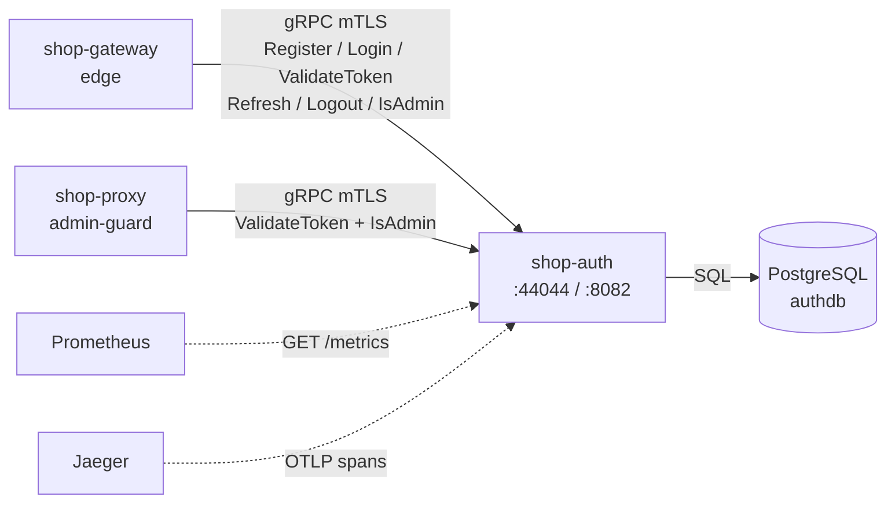
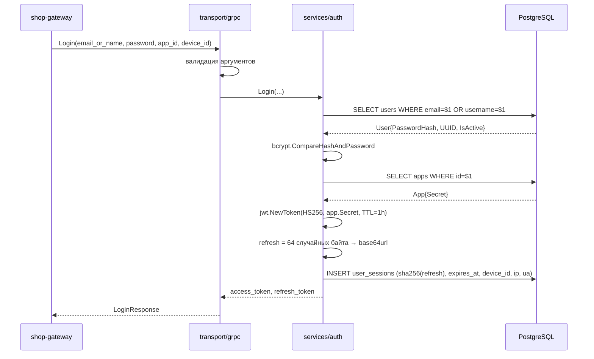
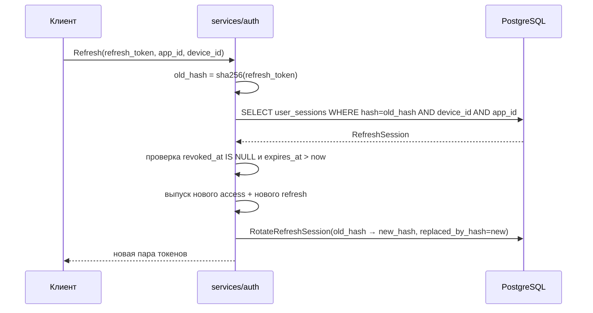
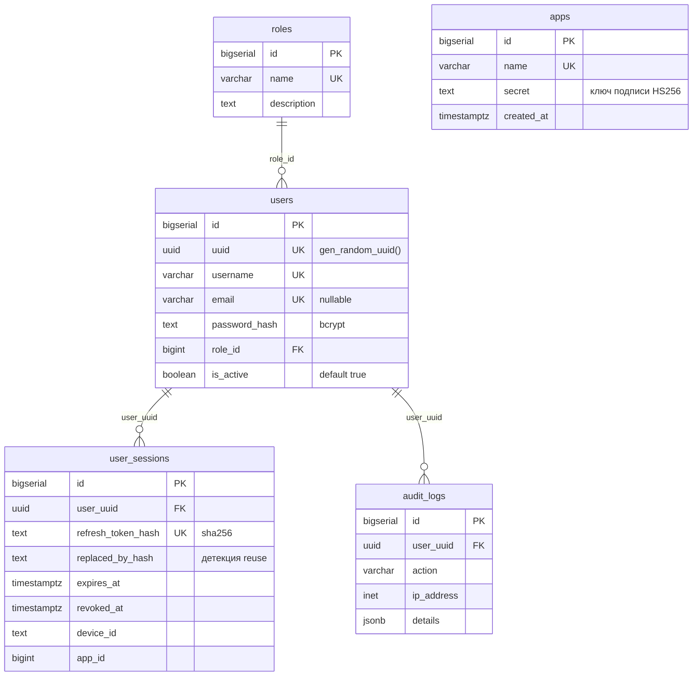

# shop-auth

Сервис аутентификации и авторизации. Владеет пользователями, приложениями-клиентами (`apps`), выпуском и проверкой JWT, refresh-сессиями и ролевой моделью.

Единственный сервис в системе, который имеет право выпускать и валидировать токены. Остальные сервисы не разбирают JWT самостоятельно — они спрашивают `shop-auth` по gRPC.

* **Модуль Go:** `sso`
* **Точка входа:** [`cmd/sso`](cmd/sso)
* **gRPC:** `:44044` — бизнес-API, в docker-режиме под mTLS
* **HTTP:** `:8082` — только эксплуатационные эндпоинты
* **Хранилище:** PostgreSQL (через `pgx` stdlib)

---

## Роль в системе



`shop-gateway` — основной потребитель: он проксирует публичный auth-flow и использует `ValidateToken` в своём middleware. `shop-proxy` обращается только за проверкой прав на собственные `/admin/*`.

---

## Структура

```text
shop-auth/
├── cmd/
│   ├── sso/              # основной сервис: gRPC + HTTP
│   ├── migrator/         # запуск миграций из кода
│   └── gateway/          # ⚠️ legacy demo-UI, см. «Известные проблемы»
├── config/
│   ├── local.yaml        # go run на хосте, Postgres :5454, TLS off
│   ├── local_tests.yaml  # конфиг интеграционных тестов
│   └── config.docker.yaml# внутри compose, mTLS on
├── migrations/           # схема authdb (golang-migrate)
└── internal/
    ├── app/              # bootstrap и lifecycle → см. app/README.md
    │   ├── grpc/         # gRPC-сервер, health, reflection
    │   └── http/         # HTTP-сервер операционных эндпоинтов
    ├── services/auth/    # бизнес-логика auth → см. services/auth/README.md
    ├── storage/          # доступ к данным → см. storage/README.md
    │   └── postgres/     # рабочая реализация
    ├── transport/
    │   ├── grpc/v1/      # gRPC API → см. transport/grpc/v1/README.md
    │   └── http/v1/      # HTTP API → см. transport/http/v1/README.md
    ├── lib/jwt/          # выпуск и разбор JWT → см. lib/jwt/README.md
    ├── domain/models/    # User, App, RefreshSession, Role, AuditLog
    └── observability/    # логи, метрики, трейсы → см. observability/README.md
```

---

## gRPC API

Контракт: [`shop-contracts/proto/auth/v1/auth.proto`](../shop-contracts/proto/auth/v1/auth.proto), сервис `proto.auth.v1.AuthService`.

| Метод | Вход | Выход | Назначение |
|---|---|---|---|
| `Register` | `email`, `password`, `username` | `user_uuid` | Создать пользователя с ролью `user` |
| `Login` | `email_or_name`, `password`, `app_id`, `device_id` | `access_token`, `refresh_token` | Выпустить пару токенов |
| `ValidateToken` | `token`, `app_id` | `user_uuid` | Проверить access-токен и активность пользователя |
| `Refresh` | `refresh_token`, `app_id`, `device_id` | новая пара токенов | Ротация refresh-сессии |
| `Logout` | `refresh_token`, `app_id`, `device_id` | `is_logout` | Отозвать refresh-сессию |
| `IsAdmin` | `user_uuid` | `is_admin` | Проверить роль `admin` |

Дополнительно зарегистрированы `grpc.health.v1.Health` (со статусом на `proto.auth.v1.AuthService`) и server reflection — последняя позволяет работать `grpcurl` без локальной копии proto.

### Коды ошибок

| Ситуация | gRPC code |
|---|---|
| Пустой обязательный аргумент, некорректный UUID | `InvalidArgument` |
| Пользователь уже существует | `AlreadyExists` |
| Пользователь или `app_id` не найдены | `NotFound` |
| Неверный пароль; просроченный, чужой или отозванный токен | `Unauthenticated` |
| Все слоты bcrypt заняты дольше `max_wait` (Login, Register) | `ResourceExhausted` + `RetryInfo` |
| Истёк дедлайн запроса | `DeadlineExceeded` |
| Всё остальное | `Internal` |

## HTTP API

Порт `:8082`, только эксплуатация — бизнес-методов здесь нет.

| Метод | Путь | Назначение |
|---|---|---|
| `GET` | `/health` | Liveness: процесс жив |
| `GET` | `/ready` | Readiness: `PingContext` к PostgreSQL |
| `GET` | `/metrics` | Prometheus |
| `GET` `POST` | `/admin/log-level` | Прочитать и сменить уровень логов на живом процессе |

---

## Потоки

### Login



Ключевое: в базу уходит **только** `sha256` от refresh-токена. Сырое значение существует лишь в ответе клиенту.

### Refresh — ротация



Старая сессия помечается `replaced_by_hash`, что даёт основу для детекции повторного использования украденного токена.

### Как работает logout

`Logout` ставит `revoked_at` на refresh-сессию. **Access-токен при этом продолжает действовать до истечения `exp`** — это осознанное следствие stateless-JWT: подписанный токен нельзя «отозвать», не проверяя состояние на сервере при каждом запросе.

Практический эффект: после выхода пользователь не может продлить сессию, но уже выданный access-токен живёт до конца TTL (по умолчанию час). Чтобы закрывать доступ мгновенно, нужен `session_id` или `token_version` в claims и его проверка в `ValidateToken`.

---

## Схема данных



`apps` — таблица клиентских приложений. У каждого свой секрет подписи, поэтому токен, выпущенный для `app_id=1`, не пройдёт валидацию с `app_id=2`. Сидируются три: `web-client` (1), `mobile-client` (2), `test-app` (100).

Таблицы `audit_logs` и `system_metrics` созданы схемой, но **код в них не пишет** — см. «Известные проблемы».

Подробнее о миграциях: [`migrations/README.md`](migrations/README.md).

---

## Модель безопасности

| Что | Как |
|---|---|
| Пароли | `bcrypt` с `DefaultCost`, сравнение через `CompareHashAndPassword` |
| Refresh-токены | 64 байта из `crypto/rand`, в БД только `sha256`-hex |
| Access-токены | JWT `HS256`, секрет берётся из `apps.secret` по `app_id` |
| Claims | `sub` (user UUID), `email`, `app_id`, `iat`, `exp` |
| Транспорт | gRPC TLS с `RequireAndVerifyClientCert`, `MinVersion: TLS 1.2` |
| Проверка клиента | Сертификат клиента проверяется против `client_ca_file` |

В docker-режиме `require_client_cert: true` — без валидного клиентского сертификата соединение не устанавливается. Локально TLS выключен целиком.

---

## Конфигурация

Путь к конфигу: флаг `--config` или переменная `CONFIG_PATH`.

| Группа | Поля | Комментарий |
|---|---|---|
| корень | `service_name`, `env`, `version`, `log_level`, `shutdown_timeout` | |
| токены | `token_ttl` (1h), `refresh_ttl` (168h) | TTL access и refresh |
| `grpc` | `port` (44044), `timeout` | |
| `http` | `port` (8082), `timeout` | |
| `postgres` | `host`, `port`, `db_name`, `user`, `password`, `ssl_mode` | DSN собирается в `postgres.DSN()` через `url.URL` |
| `postgres` (пул) | `max_open_conns` (25), `max_idle_conns` (25), `conn_max_lifetime` (5m), `conn_max_idle_time` (1m) | Потолок на **один** инстанс: `max_open_conns × инстансы < max_connections` |
| `postgres` (старт) | `statement_timeout` (5s), `connect_timeout` (5s), `connect_retries` (6) | Серверный лимит на запрос и повторы ping с удвоением паузы |
| `tls` | `enabled`, `cert_file`, `key_file`, `ca_file`, `client_ca_file`, `require_client_cert` | |
| `otlp` | `endpoint` | Пустой или недоступный — трейсинг отключается с warning, сервис поднимается |

Конфиг проходит `Validate()` при загрузке: проверяются непустые имена, положительные TTL и таймауты, корректность портов и уровня логирования. Отдельно — параметры пула: `max_open_conns` и `conn_max_lifetime` обязаны быть `> 0` (в `database/sql` `0` означает «без лимита» и «жить вечно»), а `max_idle_conns` не может превышать `max_open_conns`.

---

## Запуск

### Локально

Сначала база — в репозитории есть свой compose для разработки:

```bash
docker compose up -d postgres   # поднимает postgres:16 на :5454, БД authdb
docker compose run --rm migrate # применяет миграции
go run ./cmd/sso --config config/local.yaml
```

Или через [Taskfile](Taskfile.yaml): `task db-up`, `task migrate`, `task run`.

### Нагрузочные прогоны

Сценарии k6 по каждому gRPC-методу отдельно — в [`load/`](load/README.md). Там же порядок прогонов, таблица результатов и то, как по дашборду определить, во что именно упёрся метод.

### В составе платформы

```bash
cd ../shop-platform/deploy
docker compose up -d --build auth-service
```

Там база — общий HA-кластер Patroni через HAProxy, миграции накатывает отдельный контейнер `auth-migrate`, сертификаты приезжают volume-ом из `infra/certs`.

### Проверка

```bash
curl http://localhost:8082/health
curl http://localhost:8082/ready

# gRPC через reflection (локально, TLS выключен)
grpcurl -plaintext localhost:44044 list
grpcurl -plaintext -d '{"username":"demo","email":"demo@example.com","password":"Test123!"}' \
  localhost:44044 proto.auth.v1.AuthService/Register
```

В docker-режиме прямой вызов gRPC снаружи не пройдёт — порт требует клиентский сертификат. Штатный путь проверки — через `shop-gateway`.

---

## Observability

**Логи** — `slog` в JSON в stdout, с полями `service`, `env`, `version`. Уровень меняется на живом процессе через `/admin/log-level`.

**Метрики** — три группы:

| Метрика | Метки |
|---|---|
| `auth_service_requests_total` | `method`, `status` |
| `auth_service_request_duration_seconds` | `method` |
| `auth_http_requests_total` | `method`, `path`, `status` |
| `auth_http_request_duration_seconds` | `method`, `path` |
| `auth_grpc_requests_total` | `method`, `code` |
| `auth_grpc_request_duration_seconds` | `method` |

Сервисный слой инструментирован через `defer observability.ObserveServiceRequest(op, started, err)` в каждом методе, gRPC — unary-интерцептором.

**Трейсы** — OTLP на `otlp.endpoint`. Серверные спаны gRPC создаёт `otelgrpc` stats handler.

Подробнее: [`internal/observability/README.md`](internal/observability/README.md).

---

## Тесты

```bash
go test ./internal/...        # unit, без внешних зависимостей
```

Юнит-тесты: [`internal/services/auth/logout_test.go`](internal/services/auth/logout_test.go) и [`internal/transport/grpc/v1/server_test.go`](internal/transport/grpc/v1/server_test.go).

Интеграционные тесты в [`tests/`](tests) требуют **живого окружения**: PostgreSQL на `localhost:5454` с накатанными миграциями и запущенный gRPC-сервер на `localhost:44044`. Конфиг — `config/local_tests.yaml`.

```bash
docker compose up -d postgres && docker compose run --rm migrate
go run ./cmd/sso --config config/local_tests.yaml &
go test ./tests/...
```

Без поднятого окружения `go test ./...` упадёт на `db ping failed` — это ожидаемо, а не регрессия.

---

## Известные проблемы

Список для разбора, найден при аудите кода:

1. **Секреты подписи в миграции открытым текстом.** [`migrations/000001_init.up.sql`](migrations/000001_init.up.sql) сидит `apps.secret` значениями `web-secret`, `mobile-secret`, `test-secret`. Это ключи HS256 — зная их, можно подписать токен на любой `user_uuid`. Должны приходить из секрет-хранилища.
2. **Кэш секретов приложений без инвалидации.** `JWTAdapter.appCache` ([`internal/services/auth/jwt_adapter.go`](internal/services/auth/jwt_adapter.go)) читает `apps` один раз и держит вечно. Ротация секрета в БД не подхватится до рестарта.
3. **`TokenManager` внедрён наполовину.** `CreateToken` не вызывается никогда: `Login` и `Refresh` используют пакетный `jwt.NewToken` напрямую, а `ValidateToken` — внедрённый `tokenManager.ParseToken`.
4. **Неограниченная кардинальность метрик.** [`internal/transport/http/v1/router.go`](internal/transport/http/v1/router.go) передаёт `r.URL.Path` в метку `path` как есть. Любой запрос на несуществующий путь создаёт новый time series.
5. **`audit_logs` и `system_metrics` — мёртвая схема.** Таблицы и модель `AuditLog` есть, записи не происходит нигде.
6. **Миграции `0003_seed_roles.sql` и `0004_seed_apps.sql`** названы не по схеме `golang-migrate` (`0003_` вместо `000003_`, нет суффикса `.up`) и дублируют сиды, уже выполненные в `000001`.
7. **Незакоммиченные изменения** в `Dockerfile` на момент аудита.
8. **Оракул по времени ответа `Login`.** Несуществующий и деактивированный пользователь получают ответ за доли миллисекунды, существующий — за ~80 мс на `bcrypt`. По времени можно отличить, есть ли аккаунт. Штатное лечение — прогонять фиктивный `bcrypt` на ветке «не найден», но до появления bulkhead и rate limiting это превращает перебор в CPU-атаку, поэтому делать нужно в обратном порядке.
