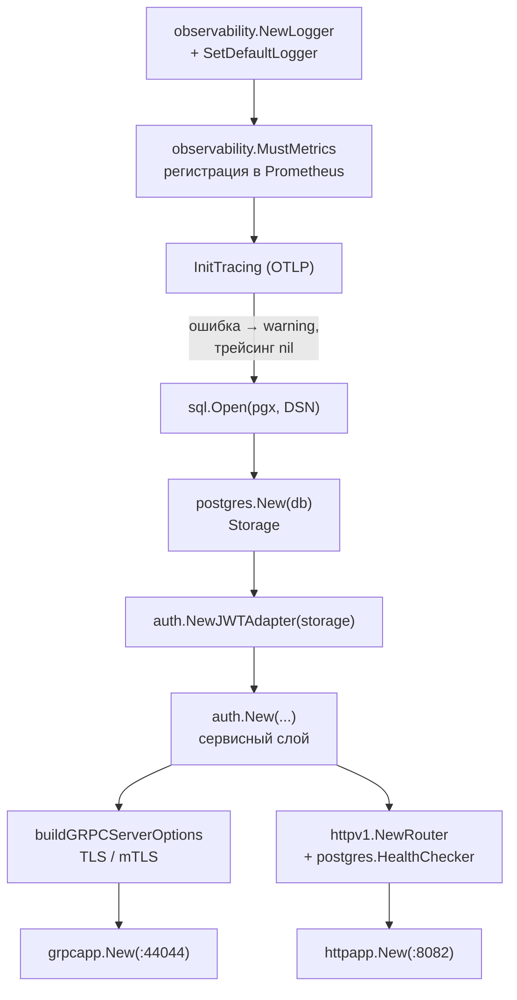

# internal/app

Композиция сервиса: собирает зависимости, владеет их временем жизни и корректно всё останавливает. Единственное место, где конкретные реализации встречаются друг с другом — все остальные пакеты знают только интерфейсы.

## Состав

| Пакет | Ответственность |
|---|---|
| `app` | Сборка графа зависимостей, `Run`, `Shutdown` |
| `app/grpc` | gRPC-сервер: интерцепторы, health, reflection |
| `app/http` | HTTP-сервер операционных эндпоинтов |

## Порядок сборки



Трейсинг — единственная необязательная зависимость: если OTLP-коллектор недоступен, сервис пишет warning и продолжает работу. PostgreSQL обязателен, без него `New` возвращает ошибку.

## Lifecycle

`Run()` поднимает оба сервера в отдельных горутинах и не блокируется. Ошибки времени выполнения уходят в канал `Errors()`, который слушает `main`.

`Shutdown(ctx)` идёт в обратном порядке и собирает все ошибки через `errors.Join`, не прерываясь на первой:

```text
1. gRPC GracefulStop         → health-статус переводится в NOT_SERVING
2. HTTP server.Shutdown(ctx) → дожидается активных запросов
3. shutdownTracing(ctx)      → флаш накопленных спанов
4. db.Close()
```

Перевод health в `NOT_SERVING` до остановки важен: балансировщик или `depends_on: service_healthy` успевает увести трафик.

## Readiness

`postgres.NewHealthChecker(db, 2s)` — это `db.PingContext` с собственным таймаутом, не наследующим срок жизни HTTP-запроса. Живой процесс без доступной базы отвечает `/health` → `200`, `/ready` → `503`.

## gRPC-сервер

[`grpc/app.go`](grpc/app.go) добавляет:

* **stats handler** OpenTelemetry — приходит из `buildGRPCServerOptions`;
* **health service** — статус `SERVING` на `proto.auth.v1.AuthService` и на пустое имя;
* **reflection** — чтобы `grpcurl` работал без локальных proto.

TLS настраивается там же, в `buildGRPCServerOptions`: `MinVersion: TLS 1.2`, а при `require_client_cert: true` — `ClientAuth: RequireAndVerifyClientCert` с пулом из `client_ca_file`.

### Цепочка интерцепторов

```text
deadlineInterceptor → metricsInterceptor → recoveryInterceptor → handler
```

Первый в `ChainUnaryInterceptor` — самый внешний. Порядок не косметический:

| Интерцептор | Зачем | Почему на этом месте |
|---|---|---|
| `deadlineInterceptor` | Ставит дедлайн из `grpc.timeout`, если клиент своего не прислал | Снаружи: под дедлайном должно работать всё остальное |
| `metricsInterceptor` | `observability.ObserveGRPCRequest(method, code, started)` | Внутри дедлайна, но снаружи recovery — иначе паники не попадают в `auth_grpc_requests_total` |
| `recoveryInterceptor` | Паника → `Internal` + лог со стеком | Вплотную к обработчику: ошибка должна появиться до того, как её увидят метрики |

Порядок закреплён тестом `TestPanicIsCountedInMetrics` в [`grpc/app_test.go`](grpc/app_test.go) — перестановка интерцепторов его уронит.

Рекавери нужен потому, что **grpc-go не перехватывает паники обработчиков**: в `server.go` нет ни одного `recover()`, и паника в любом методе роняет процесс целиком. Стримы покрыты отдельной цепочкой `ChainStreamInterceptor`, поскольку unary-интерцепторы на них не распространяются, а стримовые методы есть у `reflection` и `health.Watch`.

Текст паники клиенту не уходит: наружу отдаётся `Internal` с сообщением `internal error`, а стек остаётся в логе.

### Лимиты соединений

| Опция | Значение | Дефолт grpc-go | Зачем |
|---|---|---|---|
| `MaxConcurrentStreams` | 1000 | `math.MaxUint32` | Потолок одновременных горутин-обработчиков на соединение. При дефолте настройка вообще не отправляется клиенту, и он считает, что лимита нет |
| `KeepaliveParams.Time` / `Timeout` | 30s / 10s | 2h / 20s | Мёртвый клиент (`kill -9`, пересозданная сеть) обнаруживается за ~40 с вместо двух часов. grpc-go заодно выставляет `TCP_USER_TIMEOUT` равным `Timeout` |
| `KeepaliveParams.MaxConnectionIdle` | 5m | ∞ | Простаивающее соединение закрывается, клиент прозрачно переподключается на следующем вызове |
| `EnforcementPolicy.MinTime` | 10s | 5m | Минимальный интервал клиентских пингов. **Должен быть меньше клиентского `keepalive.Time`**, иначе сервер рвёт собственных клиентов с `ENHANCE_YOUR_CALM` |

`PermitWithoutStream` меняется только парой с клиентским: если клиент разрешит пинги без активных стримов, а сервер нет — соединение будет рваться в простое.

`MaxConnectionAge` сознательно не задан: он нужен, когда за одним адресом несколько реплик, иначе клиент с единственным долгоживущим соединением навсегда прилипает к первой. Добавлять его нужно сразу с `MaxConnectionAgeGrace`.

## Известные проблемы

* `MustRun()` в `grpcapp` паникует вместо возврата ошибки. В текущей сборке не используется, но остаётся ловушкой.
* Общего лимита одновременных запросов на инстанс нет: `MaxConcurrentStreams` ограничивает только одно соединение. Admission control и circuit breaker к базе — отдельный этап.
* `Stop()` переводит health в `NOT_SERVING` и сразу вызывает `GracefulStop()`, без паузы на увод трафика балансировщиком.
