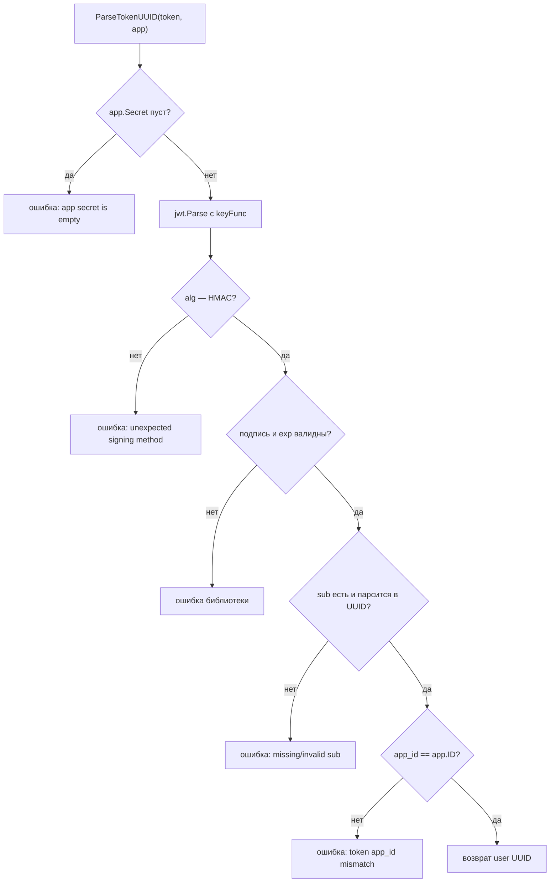

# internal/lib/jwt

Выпуск и разбор access-токенов. Обёртка над `github.com/golang-jwt/jwt/v5` с фиксированным набором claims и обязательной проверкой принадлежности токена приложению.

Пакет ничего не знает про базу: секрет и `app.ID` ему передают снаружи — их достаёт `services/auth.JWTAdapter`.

## API

```go
func NewToken(user models.User, app models.App, duration time.Duration) (string, error)
func ParseTokenUUID(tokenString string, app models.App) (uuid.UUID, error)
```

## Формат токена

Алгоритм — `HS256` (симметричный, секрет из `apps.secret`).

| Claim | Значение | Зачем |
|---|---|---|
| `sub` | UUID пользователя строкой | Идентификатор субъекта, стандартный claim |
| `email` | email или `""` если `NULL` | Удобство для потребителя, не используется в проверках |
| `app_id` | `app.ID` | Привязка токена к приложению |
| `iat` | время выпуска | |
| `exp` | `iat + duration` | Проверяется библиотекой автоматически |

`sub` — именно UUID, а не числовой `users.id`. Наружу не утекает информация о порядке регистрации и количестве пользователей.

## Проверки при разборе



Два места здесь принципиальны.

**Проверка алгоритма в `keyFunc`.** Без неё библиотеку можно заставить принять токен с `alg: none` или подсунуть RS256-токен, где публичный ключ выступит HMAC-секретом. Это классическая уязвимость JWT-библиотек, и проверка `token.Method.(*jwt.SigningMethodHMAC)` её закрывает.

**Проверка `app_id`.** У каждого приложения свой секрет, так что подпись токена для `app_id=1` не сойдётся с секретом приложения 2. Но сравнение claim с `app.ID` даёт защиту второго уровня и делает намерение явным.

`getInt64Claim` разбирает `app_id` с учётом того, что JSON-числа после десериализации приходят как `float64`.

## Известные проблемы

* **Симметричная подпись HS256.** Секрет нужен и для выпуска, и для проверки, поэтому любой сервис, который захочет валидировать токен локально, получит возможность его выпускать. Сейчас это не проблема, так как проверяет только `shop-auth`, но при переходе на локальную валидацию в gateway потребуется асимметричная схема (RS256/ES256) с публичным ключом через JWKS.
* **Нет `iss`, `aud`, `jti`.** Без `jti` невозможен чёрный список отдельных токенов, без `aud` — разграничение получателей.
* **Нет `nbf`** и запаса на рассинхрон часов между сервисами.
* **Секреты приложений хранятся в БД открытым текстом** и сидируются миграцией с предсказуемыми значениями — см. корневой README, пункт 1.
