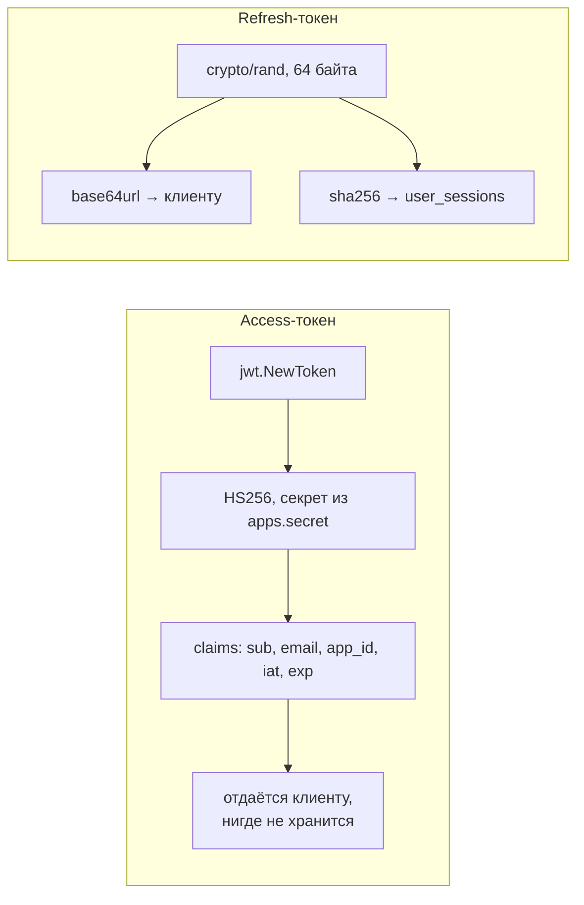

# internal/services/auth

Бизнес-логика аутентификации. Ничего не знает про gRPC, HTTP и SQL — работает через интерфейсы, которые объявлены здесь же и реализованы в `storage/postgres`.

## Зависимости как интерфейсы

Пакет объявляет узкие порты вместо одного толстого `Storage`. Это позволяет подменять части в тестах и явно показывает, что именно каждый метод трогает:

| Интерфейс | Методы | Кто реализует |
|---|---|---|
| `UserSaver` | `SaveUser` | `storage/postgres` |
| `UserProvider` | `User`, `UserByUUID`, `IsAdminByUUID` | `storage/postgres` |
| `AppProvider` | `App` | `storage/postgres` |
| `TokenManager` | `CreateToken`, `ParseToken` | `JWTAdapter` (здесь же) |
| `RefreshSessionSaver` | `SaveRefreshSession` | `storage/postgres` |
| `RefreshSessionProvider` | `RefreshSessionByHash` | `storage/postgres` |
| `RefreshSessionRotator` | `RotateRefreshSession` | `storage/postgres` |
| `RefreshSessionRevoker` | `RevokeRefreshSession` | `storage/postgres` |

## Файлы

| Файл | Содержимое |
|---|---|
| [`auth.go`](auth.go) | Шесть методов: `Login`, `RegisterNewUser`, `ValidateToken`, `Refresh`, `Logout`, `IsAdminByUUID` |
| [`refresh.go`](refresh.go) | `newRefreshToken(n)` — n случайных байт в base64url; `sha256Hex(s)` |
| [`jwt_adapter.go`](jwt_adapter.go) | `JWTAdapter` — достаёт секрет приложения из БД и кэширует, оборачивает `lib/jwt` |

## Работа с токенами



Асимметрия намеренная. Access-токен самодостаточен и не требует обращения к БД для проверки подписи. Refresh-токен — случайная строка, её нельзя подделать, а хранение только хэша означает, что утечка дампа БД не даёт возможности продлевать сессии.

## Инструментирование

Каждый публичный метод открывается одинаковой преамбулой:

```go
const op = "auth.Login"
started := time.Now()
defer func() { observability.ObserveServiceRequest(op, started, err) }()
```

Именованный возвращаемый `err` здесь обязателен — без него `defer` увидит `nil` и все запросы попадут в метрику как успешные.

## Обработка ошибок

Ошибки хранилища транслируются в доменные из пакета `storage`, транспорт затем маппит их в gRPC-коды:

| Внутри | Наружу |
|---|---|
| `ErrUserNotFound` при логине | `ErrInvalidCredentials` — чтобы не раскрывать существование аккаунта |
| Несовпадение bcrypt | `ErrInvalidCredentials` |
| Отозванная, просроченная или неизвестная сессия | `ErrInvalidToken` |
| `ErrUserNotFound` в `Refresh` | `ErrInvalidToken` → `Unauthenticated`: клиент должен сбросить токены и пойти на вход |
| `ErrUserNotFound` в `ValidateToken` | `ErrUserNotFound` → `NotFound`; gateway отвечает на него `401` |
| Отсутствующая сессия при `Logout` | `nil` — logout идемпотентен |

Приведение `ErrUserNotFound` к `ErrInvalidCredentials` — защита от user enumeration: по ответу нельзя отличить «нет такого пользователя» от «неверный пароль». Одинаковый ответ — половина защиты, вторая половина — одинаковое **время**: без bcrypt ответ «не найден» приходил бы за доли миллисекунды против ~40 мс. Поэтому на этой ветке `Login` сравнивает пароль с фиктивным хешем той же стоимости (`dummyPasswordHash`) — через тот же семафор, чтобы и отказы по перегрузке не различались.

Email, логин и username в логи не пишутся: это персональные данные. Пользователь в логах `Login` появляется по `user_uuid` после поиска, в `RegisterNewUser` — после создания.

Деактивированный пользователь отфильтровывается на уровне SQL (см. [`storage/README.md`](../../storage/README.md)), поэтому в сервис он приходит как `ErrUserNotFound` и попадает в те же ветки.

**Отказ базы не маскируется под ошибку аутентификации.** `Login`, `Refresh` и `ValidateToken` разбирают ошибку провайдера через `errors.Is(err, storage.ErrUserNotFound)` и только её переводят в доменную; всё остальное уходит наружу как `Internal`. Иначе недоступность Postgres выглядела бы как массовая невалидность токенов и разлогинивала бы всех разом — ровно в тот момент, когда сервис и так в аварии.

## Известные проблемы

* **`TokenManager.CreateToken` не вызывается.** `Login` и `Refresh` используют пакетный `jwt.NewToken` напрямую, а `ValidateToken` — внедрённый `tokenManager.ParseToken`. Абстракция работает наполовину; стоит либо провести выпуск через интерфейс, либо убрать метод.
* **Кэш секретов без инвалидации.** `JWTAdapter.getApp` кладёт `models.App` в `appCache` навсегда. Ротация `apps.secret` в БД не подхватывается до рестарта процесса. Нужен TTL или явный сброс.
* **Деактивация не обрывает выданный access-токен.** После фикса `is_active` деактивированный пользователь не войдёт и не обновит сессию, но уже выданный access живёт до `exp` — при `token_ttl: 1h` это до часа. В runbook деактивации нужен и отзыв сессий (`UPDATE user_sessions SET revoked_at = now()`), а полностью проблему закрывает `sid` в claims плюс deny-list.
* **`Refresh` не помечает reuse.** Схема хранит `replaced_by_hash`, но код не реагирует на повторное использование уже заротированного токена — а это главный признак кражи refresh-токена. Штатная реакция: отозвать всю цепочку сессий пользователя.
